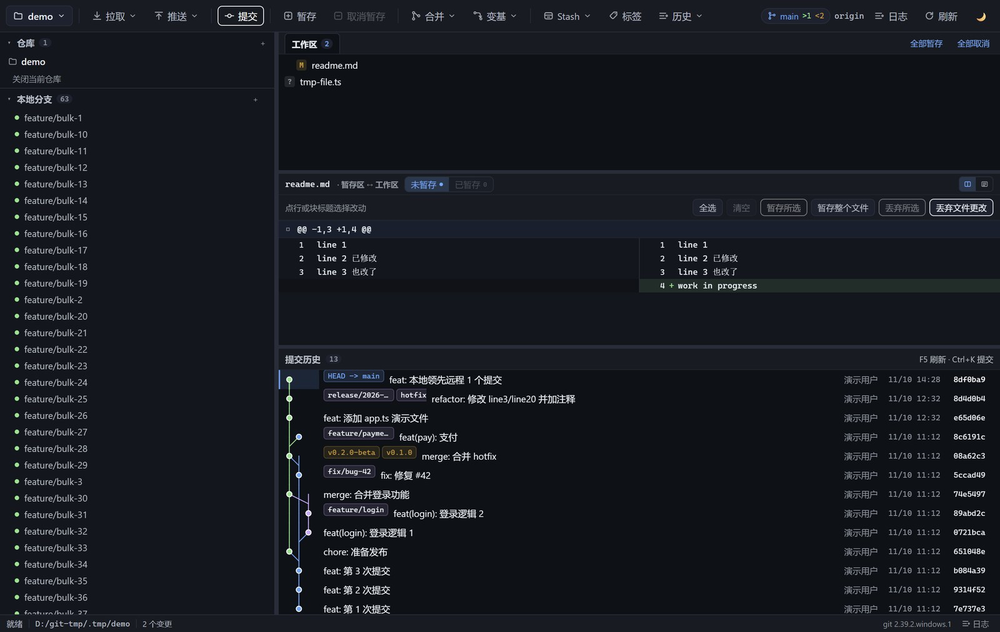
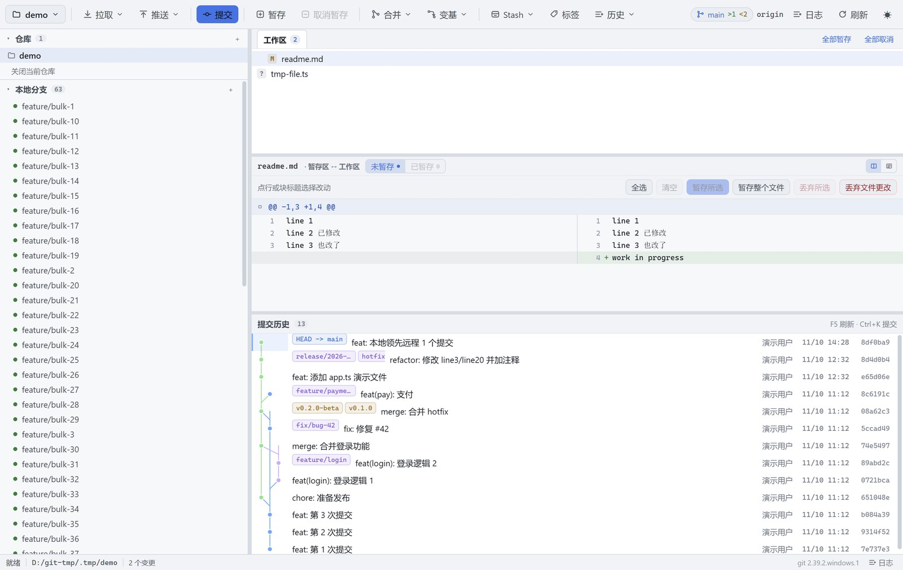

# GitDesk

[](https://github.com/zhangyn/gitDesk/actions/workflows/ci.yml)

> 轻量 Git 图形客户端 · Windows · Tauri 2 + React + TypeScript

不背 Chromium，不重写 Git。安装包 **1.21 MiB**，exe **3.2 MB**，空闲内存 **~65 MB**。



<details>
<summary>浅色主题</summary>



</details>

---

## 为什么再造一个 Git 客户端

| 痛点 | 常见客户端 | GitDesk |
| --- | --- | --- |
| 安装包 | Electron 系通常 100–200 MB | **1.21 MiB**（渲染用系统 WebView2，Git 用系统 git） |
| 行为是否可信 | GUI 悄悄改写历史，看不到实际执行了什么 | 每条操作都打印**等价的 git 命令**，可一键复制到终端重跑 |
| 大仓库 | 全量渲染，几百个分支就卡 | 提交图泳道 Canvas 自绘、宽度自适应压缩，几百条泳道也不糊 |
| 暂存粒度 | 只能整个文件 | **hunk 级 + 行级**暂存，未选中的删除行会正确降级成上下文行 |
| 敢不敢点丢弃 | 点了就没了 | 破坏性操作前自动 `git stash create` 快照到 `refs/gitdesk/backups/*`，可一键恢复 |

## 功能

**看**
- 提交历史：泳道图（拓扑序）、分支/标签徽标、作者与时间；范围可切「本地分支 + HEAD」/「含远程」
- **提交正文**：多行提交信息完整显示（超过 3 行折叠，点一下展开）
- **历史搜索**：按提交说明搜（查某件事是哪次提交做的），或按文件名搜（查一个文件都在哪些提交里改过）
- **任意两个版本对比**：分支↔分支、提交↔提交（中间隔多少次都行），列出差异文件与逐文件改动
- **文件监听**：IDE 里改完保存，GitDesk 自己就刷新了，不用按 F5
- **提交历史分页**：一次 400 条，滚到底自动续，几千条的仓库也能一路翻下去（画布按视口绘制，不受 canvas 高度上限限制）
- 分栏 diff（左＝原内容，右＝修改后），可切统一视图；标题标明两侧语义（暂存区 ↔ 工作区 / HEAD ↔ 暂存区 / 父提交 ↔ 本次提交）
- 差异块导航（`n/2` + 上下跳）、hunk 之间折叠成「⋯ N 行未改动 ⋯」
- **行内差异高亮**：改一个变量名时只高亮变的那个词（LCS 逐词比较，纯空白变化不点亮），可开关
- 双击文件行弹出**全屏 diff**，大改动也能看全
- 文件区带页签：工作区 + 每个点开的历史提交 / Stash 各占一个页签

**改**
- 变更列表合并展示：两个状态色块分别表示「暂存区」「工作区」
- **先在列表里选文件，再点工具栏「暂存 / 取消暂存」**：单击选中、Ctrl 点选多个、Shift 连选，
  按钮只作用于选中的文件；要处理全部用列表右上角的「全部暂存 / 全部取消」
- 三种粒度都支持：整文件（行内 +/−）、单个差异块（块头「暂存此块」）、具体几行（选行后「暂存所选」）
- hunk / 行级暂存：每个差异块上有「暂存此块」，也可以点行多选后「暂存所选」；丢弃同理
- 提交 / 修正上次提交 / Sign-off，提交信息走 stdin（避免 Windows 引号与编码问题）

**同步**
- fetch / pull（仅快进 · 变基 · 合并）/ push / 强制推送（`--force-with-lease`，不用 `--force`）
- 本地分支显示相对上游的 `>1`（本地多 1 个提交）/ `<2`（本地少 2 个），上游被删会标注
- **凭据弹窗**：远端要求认证时直接在应用里输入用户名 / Token 重试，可交给系统凭据管理器保存；
  密码只经环境变量传递，**不会出现在命令行和命令日志里**
- **双击远程分支**检出为本地跟踪分支（弹窗可改本地名）

**分支与冲突**
- 双击本地分支切换（单击不动作，避免误切）；新建 / 删除标签与分支
- 任意提交可「拣选」（cherry-pick）到当前分支，或「还原」（revert，生成反向提交）；冲突时走顶部继续/中止
- Stash 保存 / 应用 / Pop / 删除；单击 stash 可先看内容
- 冲突逐块决策：采用我方 / 对方 / 两者 / 对方在前，或整文件 `checkout --ours|--theirs`，写回后自动 `git add`

**多仓库与体验**
- 左栏常驻仓库列表，一次点击切换；无仓库时是「最近打开」首页
- 深色 / 浅色 / 跟随系统（连 Windows 原生标题栏一起切）
- 三段式布局，横向与纵向分隔条都可拖拽、双击复位，比例持久化

## 安装

从 [Releases](https://github.com/zhangyn/gitDesk/releases) 下载 `GitDesk_x.y.z_x64-setup.exe` 安装即可。

CI 每次推 `main` 都会构建安装包并作为 artifact 上传（14 天），打 `v*` tag 时自动发布到 Releases。

前置条件：Windows 10/11（自带 WebView2）+ 已安装 Git（`git` 在 PATH 中，≥ 2.23）。
GitDesk 默认使用系统 git，检测不到时会给出提示。

也支持命令行/右键打开：

```
GitDesk.exe D:\path\to\repo
```

## 快捷键

| 快捷键 | 作用 |
| --- | --- |
| `Ctrl+K` | 打开提交面板 |
| `F5` / `Ctrl+R` | 刷新 |
| `Ctrl+O` | 打开仓库 |
| `Ctrl+Shift+L` | 切换主题 |
| — | 提交历史右上角：按「说明 / 文件」搜索 |
| — | 工具栏「对比」：任意两个分支或提交对比；分支行 `⧉` 一键与当前分支对比 |
| `Esc` | 关闭面板 / 弹窗 |
| `↑` `↓` / `k` `j` | 在提交历史或变更列表里移动（列表需先点一下获得焦点） |
| `Space` | 在变更列表里切换当前文件的勾选 |
| `Enter` | 打开当前文件/提交的放大 diff 窗口 |
| `+` / `-` | 暂存 / 取消暂存勾选的文件 |
| `PageUp` `PageDown` `Home` `End` | 提交历史翻页与首尾 |

## 设计取舍

**为什么是 Tauri 而不是 Electron**
同等功能下 1.21 MiB vs 100+ MB，UI 代码零改动（Windows 上 WebView2 就是 Chromium 内核），
隐藏成本只有 Rust 工具链和调试体验。完整对比（含实测数据与备选方案）见
[docs/SHELL-COMPARISON.md](docs/SHELL-COMPARISON.md)。

**为什么 shell-out 而不是 libgit2 / isomorphic-git**
语义 100% 与用户命令行一致，hooks / merge / rebase / credential / ssh 全部现成，永不和 git 版本行为漂移。
代价是进程启动开销（~10–20ms），用流式和分页可以摊掉。libgit2 的 index 损坏与 rebase 支持缺失是不可接受的风险。

**为什么 Rust 只做薄壳**
Rust 侧不做任何 Git 语义，只负责 spawn 进程、超时、`taskkill` 取消、读写文件、窗口主题。
**Git 输出的解析全部在 TypeScript**，因此解析层可以脱离桌面壳单测（见下面的验证），也把换壳成本压到一个文件。

## 架构

```
WebView（React）                            src-tauri（Rust，薄壳）
┌──────────────────────────────┐            ┌──────────────────────────┐
│ src/git/runner.ts  ★唯一出口  │  invoke    │ git_run / git_cancel     │
│ src/git/ops/*      命令组装   │ ─────────► │  spawn(argv[]) + 超时     │
│ src/parse/*        纯函数解析 │ ◄───────── │  原样返回 stdout/stderr   │
│ src/features/graph 泳道 + Canvas│           │ read_text_file / write   │
│ src/store.ts       zustand    │            │ startup_repo             │
└──────────────────────────────┘            └──────────────────────────┘
```

```
src/
  git/runner.ts        唯一的 git 调用入口（换壳只改这里）
  git/ops/*            按用途分组的命令组装（log/status/diff/index/branch/remote/stash/tag/conflict）
  parse/*              porcelain v2 / log 格式 / unified diff 的纯函数解析器
  patch/build.ts       把「选中若干行」重建为可 apply 的 patch（行级暂存的核心）
  conflict/parse.ts    冲突标记解析与逐块合成
  features/graph/      泳道布局算法 + Canvas 绘制
  features/*.tsx       Toolbar / SidePanel / CenterStack / CommitList / DetailPanel / DiffView / ...
  store.ts             仓库数据 + 异步动作（zustand）
src-tauri/src/
  git_cmd.rs           spawn + 超时 + taskkill + git 探测（不含 Git 语义）
  read_file.rs         只读/写文件、启动参数
scripts/
  gen-icons.mjs        零依赖生成 PNG/ICO（node 内置 zlib）
  verify-*.ts          四组端到端验证
docs/
  PLAN.md              技术方案与设计决策记录
  SHELL-COMPARISON.md  桌面壳选型对比
```

**硬约束**（review checklist）
1. 禁止 shell 字符串拼接，一律 argv 数组。
2. Rust 侧不解析 git 输出，只转发原始文本。
3. `src/git/runner.ts` 是唯一出口，不允许出现第二个 `invoke('git_run')`。
4. 破坏性操作一律二次确认；写索引/工作区前先做备份快照。

## 验证

不依赖 Rust、不依赖网络，用**真实 git 造场景**跑端到端断言：

```bash
npm run verify     # 154/154
```

| 脚本 | 项数 | 覆盖 |
| --- | --- | --- |
| `verify-parsers.ts` | 46 | porcelain v2 / log 格式 / unified diff / 泳道布局 |
| `verify-staging.ts` | 43 | 行级暂存：选行 → 重建 patch → `git apply --cached` → **断言 index 里的精确内容** |
| `verify-remote.ts` | 25 | 本地 bare 当 origin：push -u / `pull --ff-only` 拒绝分叉 / lease 过期拒绝 / rebase 后历史线性 |
| `verify-conflict.ts` | 40 | 真实冲突逐块决策 → 合成内容；diff3 基线段、空侧、无尾换行、`=======` 误判 |
| `verify-word.ts` | 23 | 行内差异：变量名/中文/纯缩进/超长行/配对规则 |
| `verify-compare.ts` | 25 | 分支/提交对比的文件列表与统计、说明搜索、文件搜索（含"只在未合并分支上"的回归断言） |

这套验证抓到过会**写坏用户 index** 的真 bug：

- 未选中的 `-` 行必须降级成上下文行（直接删会让 git 认为要删除它）
- `\ No newline at end of file` 在「删除行被降级」时必须重写为「删除 + 原样加回」，否则会把下一行粘上来（`beta` + `gamma` → `betagamma`）

还有两个是"行为正确但范围错了"的：
- `--no-optional-locks` 是 **git 全局选项**，写到 `status` 子命令后面会让 status 直接失败（表现为"0 个变更"）
- 历史搜索里 `--branches` 必须放在 `--` **之前**，否则被当成路径，搜索范围退化成只有 HEAD

## 已知限制

- 仅支持 Windows（依赖 WebView2）
- 依赖系统 git（不内置二进制）
- 提交历史按 400 条/页加载（滚动自动续），上万条的大仓库建议配合搜索缩小范围
- 未实现 interactive rebase、cherry-pick、revert
- HTTPS 首次认证：没有缓存凭据时，要等凭据管理器（GCM）试一次（约数秒）才会弹出输入框；
  之后勾了「记住」就由系统凭据管理器接管，不再重复输入
- 泳道极多（几百个并发分支）时会压缩成细线，可切「本地分支 + HEAD」范围缓解

## 开发

前置：Node ≥ 18、Rust stable（含 MSVC 生成工具）、WebView2 Runtime。

```bash
npm install
npm run lint       # ESLint（含 react-hooks 规则）
npm run format     # Prettier 格式化；npm run format:check 只检查
npm run icons      # 生成 src-tauri/icons/*（零依赖，node 内置 zlib）
npm run app:dev    # tauri dev：vite + cargo
npm run typecheck  # tsc --noEmit
npm run verify     # 202 项断言
```

打包：

```
scripts\build-app.bat      # 产出 src-tauri/target/release/bundle/nsis/GitDesk_0.1.0_x64-setup.exe
```

（该脚本会补齐 cargo 的 PATH 并绕开「rustup 未设默认 toolchain」的情况；也可先 `rustup default stable` 后用 `npm run app:build`。）

> 换图标后必须 `touch src-tauri/src/lib.rs` 再打包，否则 exe 里的图标不会更新
> —— 图标是 `generate_context!` 在 crate 编译期嵌进去的。

## 许可

暂未指定许可证。在明确之前，默认保留所有权利。
